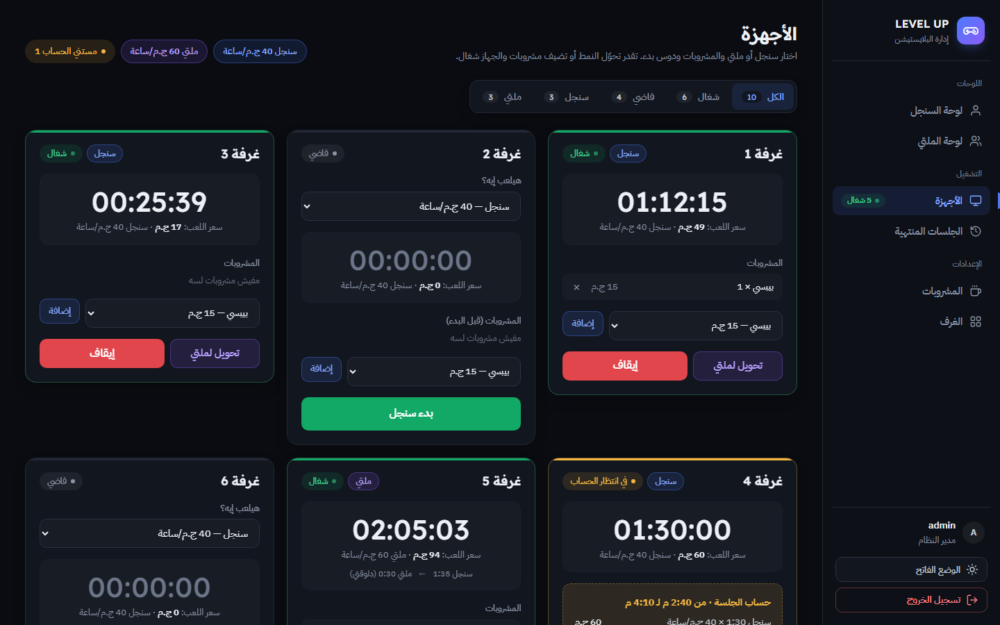
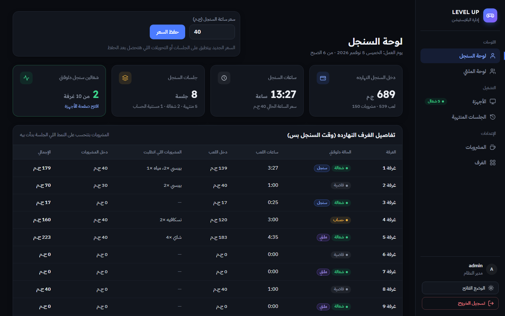
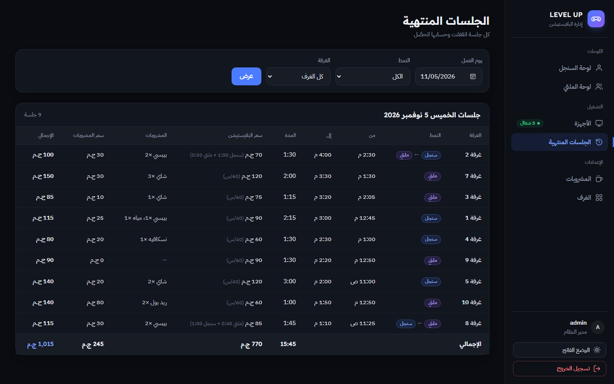
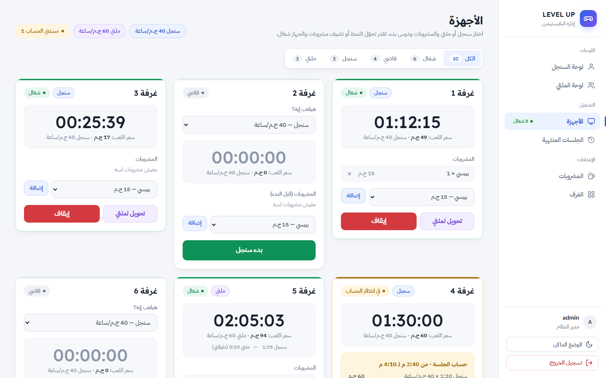

<div align="center">


# LEVEL UP — PlayStation Lounge Management System

**A fully Arabic (RTL) management system for PlayStation gaming lounges: live session timers, single/multiplayer billing, drink orders and daily revenue dashboards.**


</div>

---

## Overview

LEVEL UP is a management system built for a real PlayStation lounge. The cashier runs every room from one screen: picks single or multiplayer, starts a live timer, adds drinks to the bill, switches modes mid-session, and gets an itemized bill when the session stops. The owner sees each mode's revenue, playing hours and room breakdown for the business day.

This repository contains the **complete frontend**: eight responsive, right-to-left Arabic pages built from a client-approved mockup. The markup already uses ASP.NET Core MVC Tag Helpers (`asp-controller`, `asp-action`, `asp-route-*`, `asp-validation-for`), so it is ready to become Razor views. The **backend (ASP.NET Core MVC, .NET 9)** is in progress.

## Screenshots

| Devices board | Single-mode dashboard |
|---|---|
|  |  |

| Finished sessions | Light theme |
|---|---|
|  |  |

## Features

### Devices board
- One card per room with a **live timer** and a **play cost that updates every minute**.
- Start a session as **Single** or **Multi**, each with its own hourly rate.
- **Switch modes mid-session**: time already played is billed at its own rate and the rest at the new rate (e.g. *Single 1:35 → Multi 0:30*).
- Add or remove drinks before or during a session.
- **Stop** shows an itemized bill (each play segment, each drink, totals), with **Resume** and **Paid · Close session**.
- Filter tabs: All · Running · Idle · Single · Multi.

### Dashboards (Single & Multi)
- Today's revenue, playing hours, sessions and devices running now.
- **Editable hourly rate**: the new rate applies only to new sessions, never to past ones.
- Per-room breakdown for the day: hours, play revenue, drinks ordered, drinks revenue and totals.

### Finished sessions
- Daily log with filters by **business day**, **mode** (including switched sessions) and **room**.
- Start and end time, duration, play cost with a per-segment breakdown, drinks and grand totals.

### Drinks & rooms
- Add drinks, edit prices inline and mark a drink as **out of stock** instead of deleting it.
- Add and rename rooms, set each room's **default mode**, and **disable** rooms. A room with an active session can't be disabled.

### Across the app
- Login page, **dark and light themes** that persist with no flash on load, responsive layout down to phone size.
- Fully **Arabic and right-to-left**, typeset in IBM Plex Sans Arabic and Readex Pro.

## Business rules

| Rule | Detail |
|---|---|
| Per-minute billing | Each started minute is billed: `round(ceil(seconds / 60) × hourlyRate / 60)` |
| Rate snapshot | Every session segment stores the rate in effect when it started |
| Split billing | A mode switch closes the current segment and opens a new one |
| Business day | Starts at 6:00 AM, so late-night sessions count toward the right day |
| Drinks attribution | Drinks count toward the mode the session started in |
| No hard deletes | Drinks become unavailable and rooms are disabled, so past bills stay intact |

## Technical highlights

- **No JavaScript needed for actions.** Every action is a plain HTML form (POST, or GET for filters), so the server stays the single source of truth.
- **Only two small scripts:**
  - `theme.js` applies the saved theme in `<head>` before first paint.
  - `timer.js` drives the live timers from a server-rendered `data-elapsed` value, so a wrong client clock can't skew the time. It also updates the idle card's labels when the mode changes.
- **Server-side filtering and inline editing.** Filter tabs are `asp-route-filter` links, and inline edit rows use an `editId` route value.
- **A design-token system.** Colors, shadows and radii are CSS custom properties with full dark and light palettes, layered on Bootstrap 5.3 RTL.
- **Validation messages in Arabic** through jQuery Validation Unobtrusive (`data-val-*`), matching what ASP.NET Core generates.

## Project structure

```
├── index.html                 # Redirects to the login page
├── Account/Login.html
├── Dashboard/
│   ├── Single.html            # Single-mode dashboard + hourly rate
│   └── Multi.html             # Multi-mode dashboard + hourly rate
├── Device/Index.html          # Live devices board (filter tabs + room cards)
├── Session/Index.html         # Finished sessions log + filters
├── Drink/Index.html           # Drinks management
├── Room/Index.html            # Rooms management
├── css/
│   ├── bootstrap.rtl.min.css
│   └── style.css              # Design tokens, components, themes
├── js/
│   ├── theme.js
│   ├── timer.js
│   └── jquery*, bootstrap*    # Vendor libraries
└── images/                    # Logo and favicon
```

The folders mirror the planned MVC controllers: `Account`, `Dashboard`, `Device`, `Session`, `Drink` and `Room`.

## Getting started

No build step and no server needed. Clone the repository and open `index.html` in any modern browser:

```bash
git clone https://github.com/naiw991uen-collab/levelup-playstation-system.git
```

The pages contain consistent sample data. Action buttons submit forms that will be handled by the backend.

## Roadmap

- [x] Client-approved mockup
- [x] Static frontend: all pages, responsive, RTL, dark and light themes
- [ ] ASP.NET Core MVC backend (.NET 9): Razor views, controllers and services
- [ ] Entity Framework Core with SQLite (rooms, sessions, segments, drinks, settings)
- [ ] ASP.NET Core Identity authentication
- [ ] Offline on-premise deployment as a self-contained Windows service, with daily database backups
- [ ] Printable receipts and monthly reports

## Author

**Nasr Mohamed** · [GitHub](https://github.com/naiw991uen-collab)
